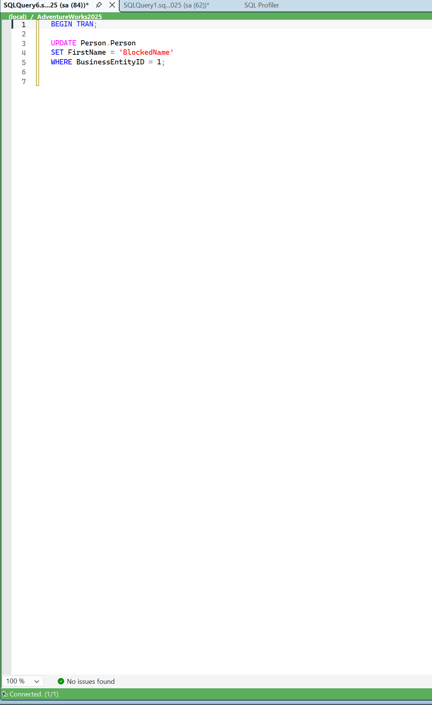

# What's New in SqlPulse

**v0.1.311 - 2026-11-11**

---

### Added
- **Connection watermark** (Settings -> Editor Background -> Connection watermark): every query editor
  shows its own connection as large faded text behind the code - server, database, alias, login, SQL
  Server version (`{version}`, e.g. 16.00.4135) and product name (`{product}`, e.g. "SQL Server 2022").
  The text is a template (one item per line; lines with only empty values are left out), with
  adjustable font size, opacity and position, colored with the connection color from Settings ->
  Connections. Editors without a connection show nothing. Follows "Change Connection" within a fraction
  of a second, and works with or without a background image. The version is read from the editor's
  already open connection - no extra query is sent to the server.

---

**v0.1.310 - 2026-11-11**

---

### Fixed
- **Update required for SSMS 22.12.** The extension installer shipped with SSMS 22.12 rejects older
  SqlPulse packages: the install fails with exit code 1012 and *"version Invalid is not vsixV1, vsixV2,
  or vsixV3"*. v0.1.310 installs again on SSMS 22.12 and stays compatible with SSMS 18-22. If you are
  on SSMS 22.12 or newer, older SqlPulse installers can no longer install or update the extension -
  please use this one.

### Added
- **Editor Background** (Settings -> Grid & Display -> Editor Background): show an image behind the
  text of every query editor - no separate extension needed. Pick a file (PNG with transparency works
  best in light and dark themes), then set opacity, stretch mode (None, Uniform, UniformToFill, Fill),
  size, position and margin. Applies to all open editors immediately and follows theme changes.
  Static images only; animated GIFs show their first frame.

---

**v0.1.305 - 2026-08-22**

---

### Changed
- **SqlPulse is now permanently free - every feature, no licence key, no activation.** The Free/Pro
  split is gone. Advanced grid filtering (multiple conditions and operators), XLSX export without a
  row cap, unlimited query history with configurable retention, the SQLite and SQL Server history
  backends and history file encryption are now available to everyone, with nothing to enter or buy.
- The extension no longer contacts any server for licensing. It never sent telemetry; now there is no
  activation call either, so it runs fully offline.

### Fixed
- **Please update if you are on 0.1.304 or older.** The free period was time-limited in code and
  would have expired on **2026-09-01**: on that date an older build silently drops to the limited
  tier - grid filter down to a single "Contains" condition, XLSX capped at 1,000 rows, history
  trimmed to 30 days - and there is no way to upgrade it, because no licence was ever sold. Updating
  to 0.1.299 removes the deadline entirely.

---

**v0.1.304 - 2026-08-03**

---

### Added
- **Conditional Formatting: AND/OR compound conditions** — rules can now combine multiple conditions (e.g. "any column is NULL" OR "City contains Budapest"), folded left-to-right the same way the Grid Filter feature already does. Older single-condition rules keep working unchanged; the shared fold/match logic now lives in one helper (`ConditionEvaluator`) used by both features instead of two separate implementations.

### Fixed
- **Conditional Formatting: a named-column condition coloured the whole row in "Matching Cell Only" mode** — a condition targeting a specific column (e.g. "City contains Budapest") acted as a row-wide gate when combined via OR, colouring every cell in a matching row instead of just that column's own cell. A named-column condition now only ever matches while painting that column's own cell.

---

**v0.1.300 - 2026-07-31**

---

### Fixed
- **Conditional Formatting: only the first matching cell per row was coloured** — a rule with no column filter (e.g. "any column equals NULL") only ever coloured the first matching cell in each row; every other cell satisfying the same condition kept its default appearance. Every matching cell in a row is now coloured independently.
- **Conditional Formatting: invalid colors rendered as hard-to-read pink text** — a bad or unparseable rule color silently fell back to a hardcoded pink instead of leaving the cell's default appearance alone.

---

**v0.1.299 - 2026-07-30**

---

### Fixed
- **Conditional Formatting: not applied on "Edit Top N Rows" grids** — SSMS's editable "Edit Top N Rows" / "Edit Data" grid (used for tables and views alike) is a different control than the read-only query results grid, so conditional formatting rules were silently never applied there — only the query results grid was ever hooked. Conditional formatting now works on both.

---

**v0.1.298 - 2026-07-14**

---

### Fixed
- **Installer: extension not visible after elevated install as a different admin account** — in environments where the day-to-day user has no admin rights, installing SqlPulse required elevating with a separate admin account. For modern SSMS (21/22), the installer used to call `VSIXInstaller.exe` without `/admin`, so the extension was registered per-user under the elevated account's own profile — invisible to the original user. The installer now defaults to an "Install for all users" mode (`/admin /force`), registering the extension in the shared per-machine Extensions folder instead, matching how legacy SSMS (18/19/20) already installed. A checkbox lets you opt back into the old per-user behavior if needed. Upgrading from an older per-user install now also cleans up the stale per-user copy so it doesn't linger alongside the new all-users one.

---

---

**v0.1.297 - 2026-05-11**

---

### Fixed
- **Sessions: Manual save counts phantom tabs** — clicking "Save Session" with zero open tabs saved a session with previously-closed tab entries (e.g. 2 tabs) instead of zero. The stale `_tabCache` merge step was removed; `EnumerateAllOpenTabs` is the authoritative source and already covers all live frames.
- **Sessions: No feedback when saving with no open tabs** — "Save Session" now shows an informational dialog ("No open SQL tabs to save.") instead of silently doing nothing.

---

---

**v0.1.295 - 2026-05-09**

---

### Fixed
- **Sessions: Incorrect tab count on manual save** — saving a session could save the wrong number of tabs (e.g. 2 or 13 when 8 were open). The save logic incorrectly included tabs that had already been closed during the session, and relied on an event-driven cache that only covered tabs the user had explicitly clicked on. The fix enumerates all currently open editor frames directly at save time, which is both accurate and independent of prior user interaction.

---

---

**v0.1.294 - 2026-05-04**

---

### Added
- **Quick Connect: Connection search** — a filter box at the top of the Quick Connect popup lets you search Preferred and Recent connections by label, server, or database name as you type. Focus lands on the search box automatically when the popup opens.
- **Quick Connect: Save current connection** — a "Save current" link in the popup header saves the active editor's server and database to Preferred Connections with a custom label. Type a name (e.g. the company name from a support ticket) and press Enter. The link is hidden when no editor connection is detected.
- **Connections: CSV import** — import bulk connections from a CSV file via **Settings → Connections → Import CSV**. Columns: `Label, Server, Database` (header row auto-detected and skipped). Quoted fields and commas inside labels are supported.

---

---

**v0.1.294 - 2026-05-04**

---

### Added
- **Quick Connect: Connection search** — a filter box at the top of the Quick Connect popup lets you search Preferred and Recent connections by label, server, or database name as you type. Focus lands on the search box automatically when the popup opens.
- **Quick Connect: Save current connection** — a "Save current" link in the popup header saves the active editor's server and database to Preferred Connections with a custom label. Type a name (e.g. the company name from a support ticket) and press Enter. The link is hidden when no editor connection is detected.
- **Connections: CSV import** — import bulk connections from a CSV file via **Settings → Connections → Import CSV**. Columns: `Label, Server, Database` (header row auto-detected and skipped). Quoted fields and commas inside labels are supported.

---

**v0.1.292 - 2026-04-03**

---

### Fixed
- **Result Grid: Horizontal/vertical scrollbar broken** — the extension was installing a transparent storage proxy layer on every result grid automatically (to support conditional formatting), which intercepted mouse events and broke scrollbar interaction. The proxy is now only installed on demand when a filter is actively applied. This restores normal grid scrolling while preserving all filter functionality.
- **DB/Job Groups: Unnecessary startup scan** — Object Explorer injector now skips initialization if no DB/Job groups are configured, reducing startup overhead and preventing UI focus interference.

### Added
- **DB/Job Groups: Enable/disable toggles** — added "Enable DB Groups" and "Enable Job Groups" checkboxes on the respective settings pages (Settings → DB Groups / Job Groups). Users can now disable the feature without deleting their group definitions.

---

---

**v0.1.288 - 2026-04-03**

---

### Added
- **Object Explorer: Global grouping toggle** — "Enable OE object grouping" checkbox on the Object Groups settings page. When unchecked, all OE grouping (custom groups + schema grouping) is disabled without deleting existing rules. The "Auto-group by schema" checkbox is grayed out when the master toggle is off.

### Fixed
- **Object Explorer: Infinite expand/collapse loop** — expanding Tables/Views/Stored Procedures nodes could enter an infinite collapse-expand loop when OE object grouping was not enabled (no custom groups, no schema grouping).

---

---

**v0.1.285 - 2026-04-02**

---

### Added
- **Object Explorer: Font size override** — configurable font size (8–24 pt) for the Object Explorer tree, settable in SqlPulse Settings → Object Groups. SSMS has a global font setting under Tools → Options → Environment → Fonts and Colors, but it affects the entire IDE and requires a restart; this setting applies instantly and is scoped to the Object Explorer only.
- **Object Explorer: Group by schema** — automatically groups Tables/Views/Stored Procedures into schema folders ("dbo (12)", "billing (5)") without manual rule setup; works alongside custom OE groups. Note: SSMS 22.4.1+ has a built-in "Group by schema" option (right-click the Tables node → Group by Schema), but it offers no color coding, no custom ordering, and no interaction with SqlPulse groups. This feature is available for all supported SSMS versions (18+).

### Changed
- **Quick Connect: Replace active tab** — hover over any connection in the Quick Connect popup to reveal a "Replace" button; clicking it switches the active query editor to that server/database without opening a new tab. Same-server switches use `IDbConnection.ChangeDatabase()`; cross-server switches (Windows Auth) replace the underlying `SqlConnection` directly via reflection. SQL Auth cross-server falls back to opening a new tab (password not stored).
- **Profiler: Pluggable Storage Sink** — async write queue (`BlockingCollection`) decouples I/O from the poll thread; four sink types: Auto (temp file, always on), File (.jsonl.gz, kept after session), SQL Server (SqlBulkCopy batch insert, auto-creates table), SQLite (local .db file); sink switchable live without data loss; export commands (CSV/JSON/SQL) read from sink when available, no OOM on large sessions
- **Profiler: Auto temp file** — even in default mode all events are streamed to `%TEMP%\SqlPulse_*.jsonl`; file deleted on session clear or sink switch; path shown in toolbar
- **Profiler: Status bar** — shows `N total (M in memory)` when in-memory buffer is smaller than the full captured history

---

---

**v0.1.285 - 2026-04-02**

---

### Added
- **Object Explorer: Font size override** — configurable font size (8–24 pt) for the Object Explorer tree, settable in SqlPulse Settings → Object Groups. SSMS has a global font setting under Tools → Options → Environment → Fonts and Colors, but it affects the entire IDE and requires a restart; this setting applies instantly and is scoped to the Object Explorer only.
- **Object Explorer: Group by schema** — automatically groups Tables/Views/Stored Procedures into schema folders ("dbo (12)", "billing (5)") without manual rule setup; works alongside custom OE groups. Note: SSMS 22.4.1+ has a built-in "Group by schema" option (right-click the Tables node → Group by Schema), but it offers no color coding, no custom ordering, and no interaction with SqlPulse groups. This feature is available for all supported SSMS versions (18+).

### Changed
- **Quick Connect: Replace active tab** — hover over any connection in the Quick Connect popup to reveal a "Replace" button; clicking it switches the active query editor to that server/database without opening a new tab. Same-server switches use `IDbConnection.ChangeDatabase()`; cross-server switches (Windows Auth) replace the underlying `SqlConnection` directly via reflection. SQL Auth cross-server falls back to opening a new tab (password not stored).
- **Profiler: Pluggable Storage Sink** — async write queue (`BlockingCollection`) decouples I/O from the poll thread; four sink types: Auto (temp file, always on), File (.jsonl.gz, kept after session), SQL Server (SqlBulkCopy batch insert, auto-creates table), SQLite (local .db file); sink switchable live without data loss; export commands (CSV/JSON/SQL) read from sink when available, no OOM on large sessions
- **Profiler: Auto temp file** — even in default mode all events are streamed to `%TEMP%\SqlPulse_*.jsonl`; file deleted on session clear or sink switch; path shown in toolbar
- **Profiler: Status bar** — shows `N total (M in memory)` when in-memory buffer is smaller than the full captured history

---

---

**v0.1.285 - 2026-04-02**

---

### Added
- **Object Explorer: Font size override** — configurable font size (8–24 pt) for the Object Explorer tree, settable in SqlPulse Settings → Object Groups. SSMS has a global font setting under Tools → Options → Environment → Fonts and Colors, but it affects the entire IDE and requires a restart; this setting applies instantly and is scoped to the Object Explorer only.
- **Object Explorer: Group by schema** — automatically groups Tables/Views/Stored Procedures into schema folders ("dbo (12)", "billing (5)") without manual rule setup; works alongside custom OE groups. Note: SSMS 22.4.1+ has a built-in "Group by schema" option (right-click the Tables node → Group by Schema), but it offers no color coding, no custom ordering, and no interaction with SqlPulse groups. This feature is available for all supported SSMS versions (18+).

### Changed
- **Quick Connect: Replace active tab** — hover over any connection in the Quick Connect popup to reveal a "Replace" button; clicking it switches the active query editor to that server/database without opening a new tab.
  
  

- **Profiler: Pluggable Storage Sink** — async write queue (`BlockingCollection`) decouples I/O from the poll thread; four sink types: Auto (temp file, always on), File (.jsonl.gz, kept after session), SQL Server (SqlBulkCopy batch insert, auto-creates table), SQLite (local .db file); sink switchable live without data loss; export commands (CSV/JSON/SQL) read from sink when available, no OOM on large sessions
- **Profiler: Auto temp file** — even in default mode all events are streamed to `%TEMP%\SqlPulse_*.jsonl`; file deleted on session clear or sink switch; path shown in toolbar
- **Profiler: Status bar** — shows `N total (M in memory)` when in-memory buffer is smaller than the full captured history

**v0.1.249 - 2026-03-31**

---

- Object Search window: added ESC shortcut to close the window

---

**v0.1.248 - 2026-03-31**

---

### Added
- **Dependency Viewer** — new window showing what a database object depends on and what uses it; supports direct (one-level) and recursive (full chain) modes; definition panel scripts the selected dependency inline
- **Object Search: View Dependencies** — "View Dependencies" button on selected search results opens the Dependency Viewer for that object
- **Editor context menu: View Dependencies** — SqlPulse → View Dependencies opens the Dependency Viewer directly from selected object name in any query editor
- **Version check

### Changed
- SMO scripting logic centralized into `ScriptObjectExecutor`; duplicate code removed from `ScriptObjectCommand` and `QueryEditorContextMenuInjector`
- `SqlObjectType.ToSmoCollection()` added as single source of truth for type → SMO collection mapping
- `SearchSmoHelper` delegation to `SmoScriptingService` fixed (was silently falling back to standalone mode inside SSMS due to wrong overload signature)
- Fix codeinspector

---

**v0.1.230 - 2026-03-29**

---

### Added
- **Keyboard Shortcuts** settings page — configurable shortcuts for all major features (Profiler, Query History, Plan Analyzer, Object Search, SQL Inspector, Quick Connect, Format SQL, Script Object)
- Foreground-only shortcut firing — hooks do not steal keystrokes from other applications
- Multi-shortcut support in `KeyboardHookService` with per-entry debounce
- **SQL Profiler** — live query capture via DMVs; blocking tree, top queries, wait stats panels; compressed session file export; one-click plan analysis for slow queries
- **Quick Connect** — floating dropdown with preferred + recent connections; toolbar button on Standard toolbar
- **Connection Strip** — thin colored bar at the bottom of every query editor showing server/database; color configurable per connection
- **Grid Conditional Formatting (Pro)** — color rows/cells by column value with 13 operators; zebra striping; condition rules override zebra layer
- **Important DB Alert** — colored floating banner on production database switch; server/database pattern matching with wildcards
- **Transaction Guard** — floating reminder for open transactions; auto-dismisses on commit/rollback
- **Object Search (Pro)** — full-text search across tables, views, procedures, functions with cached metadata
- **DB & Job Grouping (Pro)** — colored group folders in Object Explorer for databases and SQL Agent jobs
- **Plan Analyzer (Pro)** — visual execution plan tree, side-by-side plan comparison, table usage summary, operator search
- **Query Playbooks (Pro)** — multi-step query workflows with connection overrides
- **Advanced Grid Filter (Pro)** — multi-condition filters with AND/OR logic and 9 operators
- **IntelliSense schema cache warmup** — auto-warms on view attach for faster IntelliSense
- Dual build: internal VSIX (SSMS 21/22) + shell15 variant (SSMS 18/19/20)
- SMO schema cache builder for Object Search metadata

### Changed
- `KeyboardHookService` refactored: multi-shortcut list replaces single volatile fields
- Script Object shortcut moved from General settings to the new Keyboard Shortcuts page
- `ShortcutSettings.Normalize()` no longer forces "Ctrl+Shift+S" as default — allows empty key
- ThemeService refactored — consistent VS theme propagation across all settings pages
- Settings dialog (`UnifiedSettingsDialog`) unified into single tree-navigation window
- Connection detection: `DispatcherTimer` + `DTE.CommandEvents` 3-layer approach (no polling lag)
- Settings architecture: `SettingsService` singleton with clone pattern; `Normalize()` on every load
- Feature flags refactored: `FeatureFlags.IsPro` replaces scattered license checks

### Fixed
- `System.Windows.Forms.Timer` replaced by `DispatcherTimer` everywhere (WinForms timer silently fails in SSMS/WPF host)
- Installer: VSIXInstaller path fixed for SSMS 22+ (uses VS Installer service, not in-product installer)
- SQL Profiler: duplicate/malformed multi-line SQL normalization

---

[Back to README](README.md)
